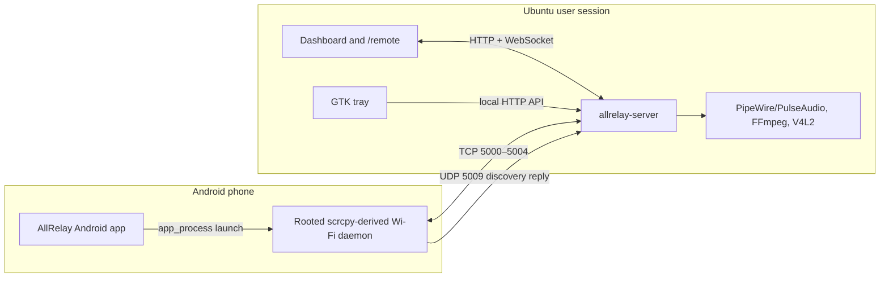
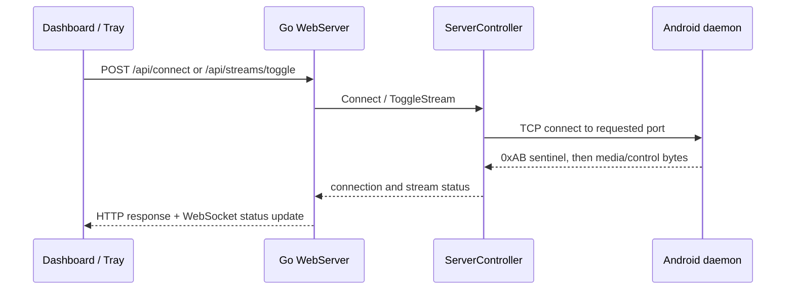
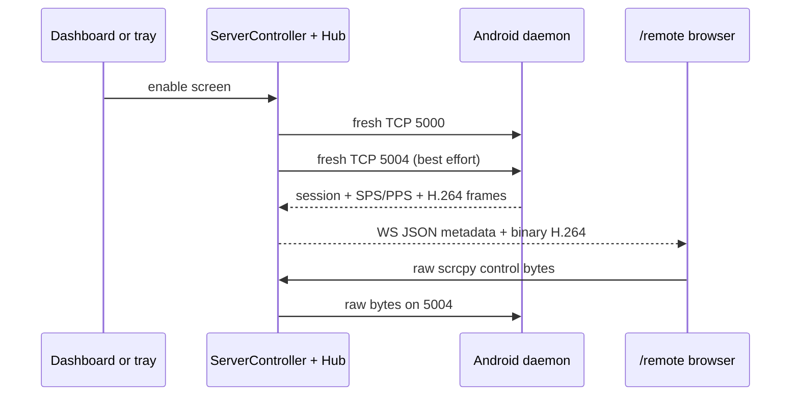
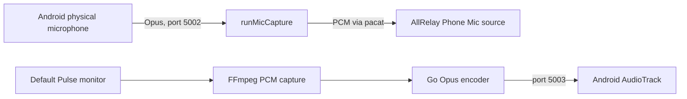

# Codebase Map

> Auto-generated by Cartographer. Last mapped: 2026-08-23T09:05:27Z
>
> The inventory includes the vendored scrcpy v4.0 tree. It is intentionally large; the active AllRelay product path is the Android Wi-Fi daemon fork plus the Ubuntu Go receiver, not the stock scrcpy desktop client.

## System Overview

AllRelay turns a rooted Android phone into a screen/control endpoint, camera, microphone input, and speaker. Android owns listening sockets; Ubuntu connects to the phone and coordinates streams. The dashboard and tray only call the local Go service.



### Runtime ownership

| Runtime | Owner | Boundary |
|---|---|---|
| Android control app | `android/app/**` | Starts/stops the rooted daemon and exposes ADB controls on phone TCP 5008. It does not carry media. |
| Android Wi-Fi daemon | `scrcpy/server/**` fork | Accepts phone media/control sockets, captures/encodes media, plays reverse speaker audio, serves discovery. |
| Ubuntu coordinator | `allrelay-server/**` | Connects to the phone, owns stream lifecycle, routes media, exposes HTTP/WebSocket. |
| Browser/tray | `internal/web/static/**`, `scripts/allrelay-tray.py` | Local clients of the Go HTTP API. Never connect to Android stream ports. |
| Packaging | `scripts/`, `deb/` | Produces the APK and Debian artifacts. |

## Directory Structure

```text
allrelay/
├── allrelay-server/                 Ubuntu Go receiver and web service
│   ├── cmd/allrelay-server/         production entrypoint
│   ├── cmd/mock-android-server/     test/manual protocol simulator
│   └── internal/
│       ├── web/                     HTTP API, controller, WebSocket hub, browser assets
│       ├── transport/               Android TCP connection and reconnect ownership
│       ├── protocol/                AllRelay 16-byte media framing and demuxer
│       ├── audio/                   Opus, PipeWire/PulseAudio and FFmpeg capture
│       ├── video/                   Annex-B inspection, FFmpeg/V4L2 output
│       ├── discovery/               route-aware UDP subnet scanner
│       └── {bitrate,control,heartbeat,input,reconnect}/  currently unwired utilities
├── android/                         AllRelay Android control application
├── scrcpy/                          vendored scrcpy v4.0, including AllRelay Wi-Fi fork
│   ├── server/                      device-side Java server; active Android daemon source
│   └── app/                         native upstream client; separate from Go product runtime
├── scripts/                         APK/Debian build helpers, shell helper and GTK tray source
├── deb/                             Debian package staging tree and user systemd units
├── assets/                          desktop launcher and icon source
├── docs/                            user docs, protocol notes, this map
└── bin/                             ignored build artifacts
```

## Module Guide

### Ubuntu receiver and stream lifecycle

**Purpose:** Connect to the phone, start/stop each media flow, publish state, and provide the only desktop-side API.

**Entry point:** `allrelay-server/cmd/allrelay-server/main.go`

| File / module | Responsibility |
|---|---|
| `internal/web/server.go` | `WebServer`, routes, current connection status, template/static lookup, dynamic URL publication. |
| `internal/web/controller.go` | `ServerController`; source of truth for connection and screen/camera/mic/speaker lifecycle. |
| `internal/transport/connection.go` | Per-port dialing, `0xAB` handshake, stream close/reconnect. |
| `internal/protocol/{packet,demuxer}.go` | Big-endian packet decoding and handler dispatch. |
| `internal/web/hub.go` | WebSocket client pumps, H.264 replay cache, status/event broadcast, raw control forwarding. |
| `internal/web/adb.go` | Dashboard-mediated Android ADB control (phone API 5008 and host `adb`). |
| `internal/discovery/scanner.go` | Default-route-aware UDP discovery. |

**Public API:** `GET /`, `GET /remote`, `GET /api/status`, `GET /api/phones`, `POST /api/phones/scan`, `POST /api/connect`, `POST /api/streams/toggle`, `GET /ws`; ADB endpoints are in `adb.go`.

**Dependency direction:** `cmd` → `web.WebServer` → `ServerController` → `transport` + media helpers. Browser/tray → HTTP/WebSocket → `web`; no reverse dependency.

**Lifecycle invariant:** `ToggleStream()` cancels and waits outside the controller mutex, then re-reads state. Each stream has `Active`, `Running`, a generation counter, cancellation function, and `done` channel. Socket closure is intentional cancellation: it wakes a demuxer blocked in `Read`.

### Four media flows

| Stream | Port / direction | Android source | Ubuntu consumer | User-facing result |
|---|---|---|---|---|
| Screen | 5000, phone → PC | `ScreenCapture` → `WifiSurfaceEncoder` H.264 | `runScreenCapture()` → Hub → browser WebCodecs | `/remote` viewer and raw input control |
| Camera | 5001, phone → PC | `CameraCapture` → H.264 | `runCameraCapture()` → FFmpeg → V4L2 | `/dev/video10` camera |
| Mic | 5002, phone → PC | `AudioSource.MIC` → Opus | `runMicCapture()` → `pacat` null sink/source | **AllRelay Phone Mic** input |
| Speaker | 5003, PC → phone | `AudioReversePlayback` → Android AudioTrack | FFmpeg monitor capture → Go Opus encoder | Phone plays PC audio |
| Control | 5004, bidirectional | scrcpy `Controller` | Hub forwards browser binary controls | Touch, keyboard, clipboard, display power |

The microphone stream is `StreamMic` on port 5002. No independent Android playback-audio stream is present.

### Android control application

**Purpose:** Native UI for root daemon lifecycle and wireless ADB support.

| File | Responsibility |
|---|---|
| `android/app/src/main/java/com/allrelay/app/ToggleActivity.kt` | Exported launcher; stream switches; Start/Restart/Stop; status polling. |
| `RootDaemonManager.kt` | Root shell launch script, JAR lookup/copy, port/process checks, Android ADB helpers. |
| `AllRelayService.kt` | Sticky foreground service with unauthenticated phone HTTP controls on port 5008. |
| `android/app/build.gradle.kts` | Bundles the scrcpy release server artifact as `allrelay.jar`. |

`RootDaemonManager` always copies the bundled APK asset, writes `/data/local/tmp/allrelay-start.sh`, clears stale ports/processes, then runs `app_process / com.genymobile.scrcpy.Server 4.0`. APK updates require an app **Restart** to change the active daemon bytecode/options. The daemon does not auto-start after reboot; open the APK and tap **Start**.

`AllRelayService` exposes `GET /health`, `GET /adb/status`, and ADB enable/disable/authorize POST endpoints on TCP 5008. Its idle auto-disable state is Android SharedPreferences, not a repository-managed file.

### Android Wi-Fi daemon fork

**Purpose:** Forked scrcpy device server adapted from ADB/local sockets to direct Wi-Fi TCP listeners.

**Entry point:** `scrcpy/server/src/main/java/com/genymobile/scrcpy/Server.java`

| File / class | Responsibility |
|---|---|
| `Options.java` | Version-locked `key=value` parser; Wi-Fi/daemon/camera/speaker options and screen-specific bitrate. |
| `Server.java` | Selects Wi-Fi vs upstream ADB runtime; persistent per-port daemon loops; mDNS/UDP discovery. |
| `device/WifiConnection.java` | One-shot multi-socket acceptor, `0xAB` sentinel, port constants and device metadata. |
| `device/WifiStreamer.java` | Writes AllRelay framed media to TCP `OutputStream`s. |
| `model/StreamId.java` | SCREEN/CAMERA/MIC/SPEAKER IDs. |
| `video/WifiSurfaceEncoder.java` | H.264 MediaCodec adapter; screen bitrate separate from camera bitrate. |
| `audio/WifiAudioEncoder.java` | Opus MediaCodec adapter for phone-originated audio. |
| `audio/AudioReversePlayback.java` | Reads reverse Opus speaker stream and plays it on Android. |
| `control/{ControlChannel,Controller}.java` | Raw scrcpy input/control protocol over port 5004. |

The fork reuses upstream capture, MediaCodec, and control implementations. Wi-Fi transport, framing, reverse playback, discovery, persistent daemon lifecycle, and option surface are the AllRelay seam.

**Constraints:** Wi-Fi listeners bind the network interface without authentication/encryption. `WifiAudioEncoder` requires Android 11+; playback-capture source has additional Android/device policy limitations. The Android server `Options.parse()` requires client version `4.0` exactly.

### Dashboard and tray

**Purpose:** Two local interfaces over one HTTP API.

| File | Responsibility |
|---|---|
| `internal/web/static/app.js` | Dashboard state, API client, `/remote` behavior, WebSocket H.264/WebCodecs, browser control serialization. |
| `internal/web/templates/{index,remote}.html` | Dashboard and standalone remote viewer documents. |
| `internal/web/static/style.css` | Dashboard/remote rendering. |
| `scripts/allrelay-tray.py` | GTK/Ayatana tray HTTP client; background worker and discovery/status polling. |
| `scripts/allrelay-helper.sh` | `allrelay open|tray|url|status|start|stop|restart|logs`. |

Dashboard screen start opens `/remote` first and tracks its popup handle. Tray opens `/remote` through `xdg-open` and has no browser-window handle, so it cannot focus/close/detect the viewer. Both submit the same `POST /api/streams/toggle` request.

The remote viewer receives H.264 video only.

### Packaging and deployment

| Artifact | Builder | Runtime cutover |
|---|---|---|
| `bin/allrelay-app-debug.apk` | `scripts/build-apk.sh` | Install APK; open app and Start/Restart daemon. |
| `bin/allrelay_<version>_amd64.deb` | `scripts/build-deb.sh` | `dpkg -i`; restart user server/tray. |

`build-apk.sh` rebuilds the Android server, bundles it in the debug APK, and removes obsolete raw-server and Magisk artifacts from `bin/`. `build-deb.sh` builds only the Go binary and desktop package.

The Debian user service runs the Go server on localhost with a dynamic port and writes `$XDG_RUNTIME_DIR/allrelay/url`. It logs to `$XDG_STATE_HOME/allrelay/remote.log`. Static/template resolution prefers `/usr/share/allrelay`; a source-tree dashboard edit is not the deployed UI until the Debian package is rebuilt/reinstalled.

### Vendored upstream scrcpy client

`scrcpy/app/**` and `scrcpy/release/**` are primarily vendored upstream host-client/release machinery. Their normal path pushes a stock server over ADB. The C client contains an AllRelay `wifi_mode` direct-connect branch (`scrcpy/app/src/server.c`), but the packaged AllRelay desktop runtime is the Go receiver, not that client.

Before touching this area, read `scrcpy/doc/develop.md`, preserve Apache-2.0 upstream notices, and synchronize any port/header/stream-order change with Android and Go. Upstream release scripts do not produce the AllRelay Debian package or Android control APK.

## Data Flow

### Connect and toggle a stream



Initial `Connect()` opens only speaker 5003. Screen, camera, mic, and control are lazy connections opened by their stream ON transitions.

### Screen and remote control



Every screen ON closes old screen/control sockets, clears replay cache, and uses a fresh generation. Hub retains current dimensions, up to four configuration frames, and one key frame so a late viewer can request `screen_init`.

### Microphone and speaker



## Conventions

- Go calls the microphone stream `mic`; it carries `AudioSource.MIC` on port 5002.
- All Android-to-Ubuntu media frames use the `internal/protocol` 16-byte big-endian header. Session frames use a different final-eight-byte width/height layout.
- Control bytes are raw scrcpy binary protocol, not JSON.
- Stream state transitions are serialized by `ServerController.mu`; blocking cancellation waits happen after releasing that mutex.
- Screen, camera, and microphone intentionally have no idle read deadline. Static screens and delayed encoders are valid; TCP close is the OFF/unblock mechanism.
- Go tests are under `allrelay-server/internal/**`; Android server unit tests are under `scrcpy/server/src/test/**`; Android app tests are under `android/app/src/test/**`.

## Gotchas

1. **Port and stream ID are coupled contracts.** Update Android `WifiConnection`/`WifiStreamer`/`StreamId`, Go `transport`/`protocol`/controller, UI status, tests, and docs together.
2. **Mic remains the only phone-to-PC audio input.** It uses `audio_source=mic`, `StreamMic`, and port 5002; Android playback audio is not streamed independently.
3. **Daemon and one-shot Android Wi-Fi modes differ.** Persistent daemon mode independently accepts/reconnects ports and wires control; one-shot mode has different metadata/control behavior.
4. **The Hub has two outbound WebSocket paths.** Text status/events and binary H.264 run on independent pumps; preserve write serialization and frame-drop behavior for slow viewers.
5. **Some Linux packages are present but unwired.** `internal/bitrate`, `heartbeat`, `reconnect`, `control`, and `input` are not reached from the production entrypoint. Do not document them as active behavior without wiring them.
6. **The Android phone control API on 5008 and Android Wi-Fi media listeners have no source-observed authentication.** Keep them on trusted local networks.
7. **The Android daemon ships only in the APK.** Run `scripts/build-apk.sh`, then install the APK and restart the daemon from the app; remove any older AllRelay Magisk module before rebooting.
8. **Do not edit `deb/usr/share/allrelay` as source.** `build-deb.sh` overwrites it from `allrelay-server/internal/web`.

## Navigation Guide

| Goal | Start here | Complete change surface | Verify |
|---|---|---|---|
| Change screen quality | `RootDaemonManager.kt`, `Options.java`, `WifiSurfaceEncoder.java` | APK artifact | Android server test, APK build, real screen viewer |
| Change browser rendering/control | `internal/web/static/app.js` | Hub framing/replay, remote template/style, touch coordinate mapping | real `/remote`, keyboard/touch/rotation/popup cases |
| Change stream lifecycle | `internal/web/controller.go` | transport socket ownership, Hub, Android daemon behavior, UI error state | repeated ON/OFF/reconnect/disconnect |
| Change microphone | Android launch `audio_source`, `Server.java`, Go `runMicCapture`, `audio/mic_output.go` | port 5002, UI labels, virtual source, docs and deployment artifacts | daemon log, PipeWire/Pulse source, calling-app input |
| Change camera | Android `CameraCapture`, Go `runCameraCapture`, `video/*` | V4L2 setup and UI status | `/dev/video10` plus real consuming app |
| Change speaker | `runSpeakerCapture`, `audio/pipeline.go`, Android `AudioReversePlayback` | port 5003 framing and cancellation queue | audio reaches phone without stale backlog |
| Change protocol/port | `StreamId`, `WifiConnection`, `WifiStreamer` | Go `protocol`, `transport`, controller, tests, client seams | packet + connection tests and live cross-device stream |
| Change discovery | Android `startUdpResponder`, Go `discovery/scanner.go` | dashboard/tray scan API | default route, VPN/Docker, manual IP fallback |
| Change dashboard API | `internal/web/server.go` | Hub events, `app.js`, tray parsing | HTTP response, WebSocket, tray refresh |
| Change deployment | `scripts/build-apk.sh`, `scripts/build-deb.sh`, `deb/` | APK/desktop artifact consumer and service restart | installed artifact, not source checkout |

## Verification Commands

```bash
cd allrelay-server && go test ./...
cd scrcpy && ANDROID_HOME=/home/vmn/android-sdk ./gradlew :server:testDebugUnitTest
cd android && ANDROID_HOME=/home/vmn/android-sdk ./gradlew :app:compileDebugKotlin
./scripts/build-apk.sh
```

These validate source-level contracts only. A connected-phone smoke test is still required for Android capture permissions, Wi-Fi lifecycle, PipeWire/V4L2 routing, WebCodecs rendering, and Discord behavior.
